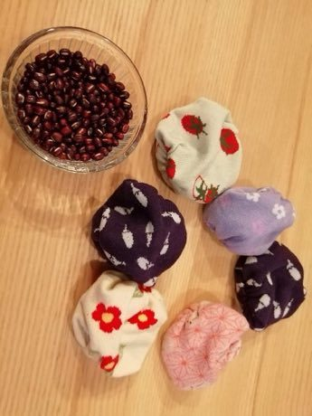

# Otedama

*Also known as: お手玉 · beanbag juggling and catch*

**Encyclopedia ID 131** (permanent) · https://bpupadhyaya.github.io/world-heritage-games-site/games/131-otedama/

*Photo: つくる暮らし, [CC BY 2.0](https://creativecommons.org/licenses/by/2.0/), [source on Wikimedia Commons](https://commons.wikimedia.org/wiki/File:Otedama_-_2020.jpg)*

Toss and catch two to five cloth beanbags in set patterns (one up, scoop, chain), finishing each pattern without a drop; songs set the rhythm.

## Heritage note

Part of the living heritage of Japan.

## Origins

Usually placed in the era of Modern Heritage (1800 to today), although its exact origins are uncertain, within the cultural world of Japan and Korea.

## Facts

- **Where:** Japan
- **Type:** Dexterity and skill games
- **Family:** Tag, chase and hide games
- **Era:** [Modern Heritage](../../eras/modern/index.md) (uncertain)
- **Cradle:** [Japan and Korea](../../cradles/japan-korea/index.md)
- **Region:** East and Southeast Asia

## Related entries

- [Kho-Kho](../../games/15-kho-kho/index.md)
- [Cheese Rolling Hill](../../games/70-cheese-rolling-hill/index.md)
- [Blind Man's Buff](../../games/467-blind-mans-buff/index.md)
- [Gollachut](../../games/573-gollachut/index.md)
- [Burn-out](../../games/654-burn-out/index.md)
- [Ligrin](../../games/657-ligrin/index.md)

## Sources

- <https://commons.wikimedia.org/wiki/File:Otedama_-_2020.jpg>
