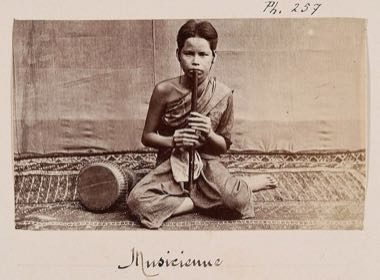

# Khloy bamboo duct flute

*Also known as: khloy · ខ្លុយ*

**Encyclopedia ID 1311** (permanent) · https://bpupadhyaya.github.io/world-heritage-games-site/games/1311-khloy-bamboo-duct-flute/

*Photo: Emile Gsell, [CC BY-SA 4.0](https://creativecommons.org/licenses/by-sa/4.0/), [source on Wikimedia Commons](https://commons.wikimedia.org/wiki/File:Khloy.jpg)*

Cover the finger holes and blow gently to match falling note bars of traditional Khmer tunes, in a sandbox mode where players can improvise.

## Heritage note

Part of the living heritage of Cambodia. Some forms of this practice carry deep meaning for the communities who keep it; here we describe the play and the craft only, with respect for its roots.

## Origins

Usually placed in the era of Classical Worlds (about 1000 BCE to 500 CE), although its exact origins are uncertain, within the cultural world of Southeast Asia and the Islands.

## Facts

- **Where:** Cambodia
- **Type:** Musical instruments
- **Family:** Wind instruments
- **Era:** [Classical Worlds](../../eras/classical/index.md) (uncertain)
- **Cradle:** [Southeast Asia and the Islands](../../cradles/southeast-asia/index.md)
- **Region:** East and Southeast Asia

## Related entries

- [Dizi](../../games/132-dizi/index.md)
- [Fujara](../../games/135-fujara/index.md)
- [Shakuhachi](../../games/349-shakuhachi/index.md)
- [Kurai](../../games/1237-kurai/index.md)
- [Khene](../../games/145-khene/index.md)
- [Egrang](../../games/17-egrang/index.md)

## Sources

- <https://commons.wikimedia.org/wiki/File:Khloy.jpg>
- <https://en.wikipedia.org/wiki/Khloy>
