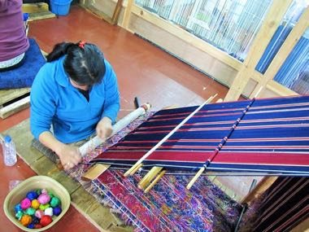

# Kira and Kushuthara backstrap weaving

*ཀི་ར། (kira)*

**Encyclopedia ID 1312** (permanent) · https://bpupadhyaya.github.io/world-heritage-games-site/games/1312-kira-and-kushuthara-backstrap-weaving/

*Photo: Chuck Moravec, [CC BY 2.0](https://creativecommons.org/licenses/by/2.0/), [source on Wikimedia Commons](https://commons.wikimedia.org/wiki/File:Thimphu_Kira_Weaving_(23676158861).jpg)*

Lift and drop warp threads to pick out a stripe-and-motif cloth row by row on a backstrap or frame loom, matching a pattern card within the thread budget.

## Heritage note

Part of the living heritage of Bhutan.

## Origins

A living tradition passed from person to person; it is not tied to a single dated origin. It belongs to the cultural world of South Asia.

## Facts

- **Where:** Bhutan
- **Type:** Crafts and making
- **Family:** Textile and weaving crafts
- **Era:** [Living Traditions](../../eras/living/index.md)
- **Cradle:** [South Asia](../../cradles/south-asia/index.md)
- **Region:** South and Central Asia

## Related entries

- [Dhaka weave pattern loom](../../games/115-dhaka-weave-pattern-loom/index.md)
- [Phulkari darn-stitch embroidery](../../games/257-phulkari-darn-stitch-embroidery/index.md)
- [Bandhani tie-dye](../../games/258-bandhani-tie-dye/index.md)
- [Kantha running-stitch quilt](../../games/284-kantha-running-stitch-quilt/index.md)
- [Nakshi Kantha embroidery](../../games/294-nakshi-kantha-embroidery/index.md)
- [Allo nettle fibre weaving](../../games/1228-allo-nettle-fibre-weaving/index.md)

## Sources

- <https://commons.wikimedia.org/wiki/File:Thimphu_Kira_Weaving_(23676158861).jpg>
