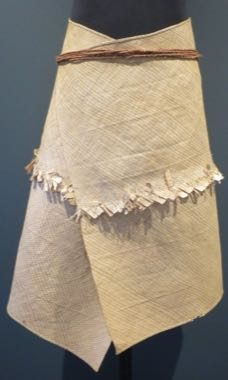

# Pandanus mat plaiting

*Te kie · te kie*

**Encyclopedia ID 1313** (permanent) · https://equalinformation.com/world-heritage-games-site/games/1313-pandanus-mat-plaiting/

*Photo: Hiart, [CC0](https://creativecommons.org/publicdomain/zero/1.0/), [source on Wikimedia Commons](https://commons.wikimedia.org/wiki/File:Man%27s_dance_mat_from_Fanning_Island,_Kiribati,_Honolulu_Museum_of_Art_accession_2013.JPG)*

Plait strips of pandanus over and under on a grid, choosing the weave to create bold geometric bands on a mat, apron or dance mat.

## Heritage note

Part of the living heritage of Kiribati.

## Origins

A living tradition passed from person to person; it is not tied to a single dated origin. It belongs to the cultural world of Pacific and Oceania.

## Facts

- **Where:** Kiribati
- **Type:** Crafts and making
- **Family:** Paper, ink and painting crafts
- **Era:** [Living Traditions](../../eras/living/index.md)
- **Cradle:** [Pacific and Oceania](../../cradles/pacific/index.md)
- **Region:** Oceania and Pacific

## Related entries

- [Lei making](../../games/449-lei-making/index.md)
- [Masi bark-cloth stencil printing](../../games/1279-masi-bark-cloth-stencil-printing/index.md)
- [Ngatu bark-cloth pattern rubbing](../../games/1385-ngatu-bark-cloth-pattern-rubbing/index.md)
- [Ebru paper marbling](../../games/20-ebru-paper-marbling/index.md)
- [Ndebele geometric wall painting](../../games/23-ndebele-geometric-wall-painting/index.md)
- [Chinese knotting](../../games/26-chinese-knotting/index.md)

## Sources

- <https://commons.wikimedia.org/wiki/File:Man%27s_dance_mat_from_Fanning_Island,_Kiribati,_Honolulu_Museum_of_Art_accession_2013.JPG>
