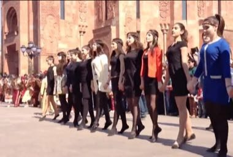

# Kochari

*Also known as: Քոչարի · Armenian line dance*

**Encyclopedia ID 1315** (permanent) · https://bpupadhyaya.github.io/world-heritage-games-site/games/1315-kochari/

*Photo: Hayordi, [CC BY-SA 4.0](https://creativecommons.org/licenses/by-sa/4.0/), [source on Wikimedia Commons](https://commons.wikimedia.org/wiki/File:Kochari_-_Armenian_folk_dance.png)*

Hold shoulders in a line and hit stamps, kicks and swings on the beat as the lead calls the pattern.

## Heritage note

Part of the living heritage of Armenia.

## Origins

A living tradition passed from person to person; it is not tied to a single dated origin. It belongs to the cultural world of Persia, Caucasus and Central Asia.

## Facts

- **Where:** Armenia
- **Type:** Dances
- **Family:** Folk and line dances
- **Era:** [Living Traditions](../../eras/living/index.md)
- **Cradle:** [Persia, Caucasus and Central Asia](../../cradles/persia-central-asia/index.md)
- **Region:** Europe

## Related entries

- [Attan circle dance](../../games/234-attan-circle-dance/index.md)
- [Yalli](../../games/1400-yalli/index.md)
- [Dabke line dance](../../games/37-dabke-line-dance/index.md)
- [Gumboot dance rhythm](../../games/123-gumboot-dance-rhythm/index.md)
- [Balkan Kolo](../../games/134-balkan-kolo/index.md)
- [Tahtib](../../games/157-tahtib/index.md)

## Sources

- <https://commons.wikimedia.org/wiki/File:Kochari_-_Armenian_folk_dance.png>
