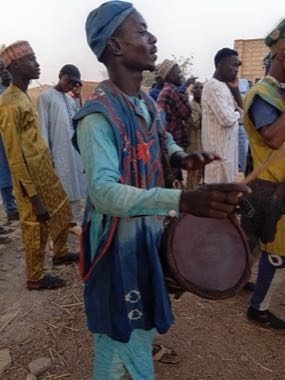

# Kokawa Hausa Wrestling

*Kokawa / Ƙauraye*

**Encyclopedia ID 1316** (permanent) · https://bpupadhyaya.github.io/world-heritage-games-site/games/1316-kokawa-hausa-wrestling/

*Photo: M Bash Ne, [CC BY-SA 4.0](https://creativecommons.org/licenses/by-sa/4.0/), [source on Wikimedia Commons](https://commons.wikimedia.org/wiki/File:Musicians_of_the_traditional_%C6%98auraye_wrestling_3.jpg)*

Grip, hook and trip a rival in a ring of spectators until a knee or back touches the sand, with drummers' tempo rising as the bout nears its end.

## Heritage note

Part of the living heritage of Nigeria, Niger.

## Origins

Usually placed in the era of River Valleys and First Cities (about 3000 to 1000 BCE), although its exact origins are uncertain, within the cultural world of Africa: Sahel, West and Central.

## Facts

- **Where:** Nigeria, Niger
- **Type:** Wrestling and martial sports
- **Family:** Wrestling
- **Era:** [River Valleys and First Cities](../../eras/river-valleys/index.md) (uncertain)
- **Cradle:** [Africa: Sahel, West and Central](../../cradles/africa-west/index.md)
- **Region:** Sub-Saharan Africa

## Related entries

- [Laamb Wrestling Bout](../../games/166-laamb-wrestling-bout/index.md)
- [Traditional wrestling](../../games/619-traditional-wrestling/index.md)
- [Kurash](../../games/253-kurash/index.md)
- [Kushti / Pehlwani mud wrestling](../../games/256-kushti-pehlwani-mud-wrestling/index.md)
- [Sumo bout](../../games/359-sumo-bout/index.md)
- [Ssireum](../../games/366-ssireum/index.md)

## Sources

- <https://commons.wikimedia.org/wiki/File:Musicians_of_the_traditional_%C6%98auraye_wrestling_3.jpg>
