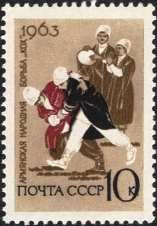

# Kokh

*Կոխ · Armenian wrestling*

**Encyclopedia ID 1317** (permanent) · https://equalinformation.com/world-heritage-games-site/games/1317-kokh/

*Photo: Post of the Soviet Union (Рис.: В. В. Пименов (1920—2008))., [Public domain](https://creativecommons.org/publicdomain/mark/1.0/), [source on Wikimedia Commons](https://commons.wikimedia.org/wiki/File:The_Soviet_Union_1963_CPA_2912_stamp_(Regional_Sports._Armenian_wrestling_%27Kokh%27).jpg)*

Two wrestlers in traditional costume grapple to throw the opponent onto the back using timed grips and counters.

## Heritage note

Part of the living heritage of Armenia.

## Origins

Usually placed in the era of River Valleys and First Cities (about 3000 to 1000 BCE), although its exact origins are uncertain, within the cultural world of Persia, Caucasus and Central Asia.

## Facts

- **Where:** Armenia
- **Type:** Wrestling and martial sports
- **Family:** Wrestling
- **Era:** [River Valleys and First Cities](../../eras/river-valleys/index.md) (uncertain)
- **Cradle:** [Persia, Caucasus and Central Asia](../../cradles/persia-central-asia/index.md)
- **Region:** Europe

## Related entries

- [Kurash](../../games/253-kurash/index.md)
- [Chidaoba](../../games/734-chidaoba/index.md)
- [Gushtingiri wrestling](../../games/1133-gushtingiri-wrestling/index.md)
- [Laamb Wrestling Bout](../../games/166-laamb-wrestling-bout/index.md)
- [Kushti / Pehlwani mud wrestling](../../games/256-kushti-pehlwani-mud-wrestling/index.md)
- [Sumo bout](../../games/359-sumo-bout/index.md)

## Sources

- <https://commons.wikimedia.org/wiki/File:The_Soviet_Union_1963_CPA_2912_stamp_(Regional_Sports._Armenian_wrestling_%27Kokh%27).jpg>
