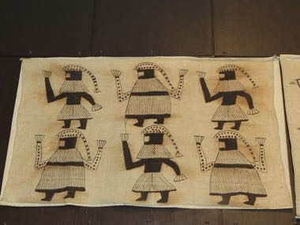

# Korhogo Painted Cloth Studio

*Tissu de Korhogo*

**Encyclopedia ID 1318** (permanent) · https://bpupadhyaya.github.io/world-heritage-games-site/games/1318-korhogo-painted-cloth-studio/

*Photo: Mickey Mystique, [CC BY-SA 4.0](https://creativecommons.org/licenses/by-sa/4.0/), [source on Wikimedia Commons](https://commons.wikimedia.org/wiki/File:Korhogo_cloth,_Senufo_people,_Ivory_Coast_01.jpg)*

Trace and fill rows of birds, hunters and animals on hand-woven cotton with brown mud pigment, repeating motifs in strict bands.

## Heritage note

Part of the living heritage of Cote d'Ivoire. Animals are partners in this tradition; good care and local rules always come first.

## Origins

A living tradition passed from person to person; it is not tied to a single dated origin. It belongs to the cultural world of Africa: Sahel, West and Central.

## Facts

- **Where:** Cote d'Ivoire
- **Type:** Crafts and making
- **Family:** Paper, ink and painting crafts
- **Era:** [Living Traditions](../../eras/living/index.md)
- **Cradle:** [Africa: Sahel, West and Central](../../cradles/africa-west/index.md)
- **Region:** Sub-Saharan Africa

## Related entries

- [Adinkra Cloth Stamping](../../games/170-adinkra-cloth-stamping/index.md)
- [Bogolan mud cloth](../../games/86-bogolan-mud-cloth/index.md)
- [Kuba cloth pattern puzzle](../../games/91-kuba-cloth-pattern-puzzle/index.md)
- [Tiebele House Painting](../../games/174-tiebele-house-painting/index.md)
- [Asafo Flag Appliqué](../../games/1230-asafo-flag-applique/index.md)
- [Dahomey Appliqué Panel Studio](../../games/1262-dahomey-applique-panel-studio/index.md)

## Sources

- <https://commons.wikimedia.org/wiki/File:Korhogo_cloth,_Senufo_people,_Ivory_Coast_01.jpg>
