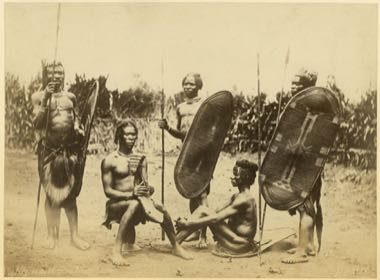

# Zande kundi arched harp

*Also known as: Kundi*

**Encyclopedia ID 1319** (permanent) · https://bpupadhyaya.github.io/world-heritage-games-site/games/1319-zande-kundi-arched-harp/

*Photo: Richard Buchta (1845-1894), [Public domain](https://creativecommons.org/publicdomain/mark/1.0/), [source on Wikimedia Commons](https://commons.wikimedia.org/wiki/File:Richard_Buchta_-_Zande_men_with_shields,_harp.jpg)*

Pluck the five to seven strings of the arched harp, following melodic patterns with call-and-response.

## Heritage note

Part of the living heritage of South Sudan. Some forms of this practice carry deep meaning for the communities who keep it; here we describe the play and the craft only, with respect for its roots.

## Origins

Usually placed in the era of Classical Worlds (about 1000 BCE to 500 CE), although its exact origins are uncertain, within the cultural world of Africa: Nile and the Horn.

## Facts

- **Where:** South Sudan
- **Type:** Musical instruments
- **Family:** String instruments
- **Era:** [Classical Worlds](../../eras/classical/index.md) (uncertain)
- **Cradle:** [Africa: Nile and the Horn](../../cradles/africa-nile/index.md)
- **Region:** Sub-Saharan Africa

## Related entries

- [Krar lyre](../../games/126-krar-lyre/index.md)
- [Morin khuur](../../games/34-morin-khuur/index.md)
- [Kathputli string puppets](../../games/79-kathputli-string-puppets/index.md)
- [Valiha tube zither](../../games/124-valiha-tube-zither/index.md)
- [Joropo llanero band](../../games/130-joropo-llanero-band/index.md)
- [Kanklės](../../games/136-kankles/index.md)

## Sources

- <https://commons.wikimedia.org/wiki/File:Richard_Buchta_-_Zande_men_with_shields,_harp.jpg>
