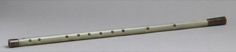

# Dizi

*Also known as: 笛子 · bamboo flute*

**Encyclopedia ID 132** (permanent) · https://bpupadhyaya.github.io/world-heritage-games-site/games/132-dizi/

*Photo: Metropolitan Museum of Art, [CC0](https://creativecommons.org/publicdomain/zero/1.0/), [source on Wikimedia Commons](https://commons.wikimedia.org/wiki/File:Dizi_MET_mi65.149.R.jpg)*

Blow-and-cover finger holes in time to scrolling notes; the membrane hole gives a buzzing bright tone.

## Heritage note

Part of the living heritage of China. Some forms of this practice carry deep meaning for the communities who keep it; here we describe the play and the craft only, with respect for its roots.

## Origins

Usually placed in the era of Classical Worlds (about 1000 BCE to 500 CE), although its exact origins are uncertain, within the cultural world of China.

## Facts

- **Where:** China
- **Type:** Musical instruments
- **Family:** Wind instruments
- **Era:** [Classical Worlds](../../eras/classical/index.md) (uncertain)
- **Cradle:** [China](../../cradles/china/index.md)
- **Region:** East and Southeast Asia

## Related entries

- [Fujara](../../games/135-fujara/index.md)
- [Shakuhachi](../../games/349-shakuhachi/index.md)
- [Kurai](../../games/1237-kurai/index.md)
- [Khloy bamboo duct flute](../../games/1311-khloy-bamboo-duct-flute/index.md)
- [Tea Horse Road Caravan](../../games/39-tea-horse-road-caravan/index.md)
- [Cuju](../../games/333-cuju/index.md)

## Sources

- <https://commons.wikimedia.org/wiki/File:Dizi_MET_mi65.149.R.jpg>
