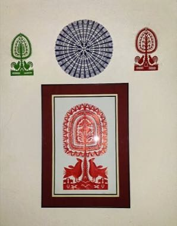

# Kurpie Layered Paper Cutting

*Also known as: Wycinanka kurpiowska*

**Encyclopedia ID 1320** (permanent) · https://bpupadhyaya.github.io/world-heritage-games-site/games/1320-kurpie-layered-paper-cutting/

*Photo: Maria Weronika Kmoch, [CC BY-SA 4.0](https://creativecommons.org/licenses/by-sa/4.0/), [source on Wikimedia Commons](https://commons.wikimedia.org/wiki/File:Wycinanka_El%C5%BCbieta_Prusaczyk_Tatary_Kurpie.jpg)*

Fold and cut a single sheet into the symmetric tree-of-life, rooster and rosette designs of the Kurpie region, then layer coloured cut-outs to decorate the room.

## Heritage note

Part of the living heritage of Poland.

## Origins

A living tradition passed from person to person; it is not tied to a single dated origin. It belongs to the cultural world of Northern and Eastern Europe.

## Facts

- **Where:** Poland
- **Type:** Crafts and making
- **Family:** Paper, ink and painting crafts
- **Era:** [Living Traditions](../../eras/living/index.md)
- **Cradle:** [Northern and Eastern Europe](../../cradles/north-east-europe/index.md)
- **Region:** Europe

## Related entries

- [Paper Soccer](../../games/464-paper-soccer/index.md)
- [Malarstwo Zalipia](../../games/19992-malarstwo-zalipia/index.md)
- [Matryoshka](../../games/28-matryoshka/index.md)
- [Khokhloma Pattern Painting](../../games/102-khokhloma-pattern-painting/index.md)
- [Rosemaling](../../games/120-rosemaling/index.md)
- [Petrykivka painting](../../games/381-petrykivka-painting/index.md)

## Sources

- <https://commons.wikimedia.org/wiki/File:Wycinanka_El%C5%BCbieta_Prusaczyk_Tatary_Kurpie.jpg>
