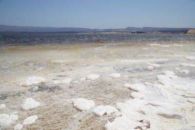

# Lake Assal salt harvest

*Lac Assal*

**Encyclopedia ID 1321** (permanent) · https://bpupadhyaya.github.io/world-heritage-games-site/games/1321-lake-assal-salt-harvest/

*Photo: Mheidegger, [CC BY 4.0](https://creativecommons.org/licenses/by/4.0/), [source on Wikimedia Commons](https://commons.wikimedia.org/wiki/File:Assal_Lake,_2024.jpg)*

Rake salt from the shore, load camels, and trade at market while managing heat and load.

## Heritage note

Part of the living heritage of Djibouti.

## Origins

Usually placed in the era of Crossroads and Golden Ages (about 500 to 1500), although its exact origins are uncertain, within the cultural world of Africa: Nile and the Horn.

## Facts

- **Where:** Djibouti
- **Type:** Sports with animal partners
- **Family:** Horse and animal sports
- **Era:** [Crossroads and Golden Ages](../../eras/crossroads/index.md) (uncertain)
- **Cradle:** [Africa: Nile and the Horn](../../cradles/africa-nile/index.md)
- **Region:** Sub-Saharan Africa

## Related entries

- [Sahel Salt Caravan](../../games/172-sahel-salt-caravan/index.md)
- [Horn of Africa camel caravan](../../games/1270-horn-of-africa-camel-caravan/index.md)
- [Ladu](../../games/674-ladu/index.md)
- [Wave riding](../../games/76-wave-riding/index.md)
- [Cirit](../../games/156-cirit/index.md)
- [Tbourida](../../games/164-tbourida/index.md)

## Sources

- <https://commons.wikimedia.org/wiki/File:Assal_Lake,_2024.jpg>
