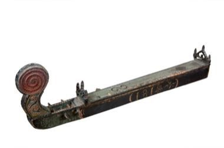

# Langeleik

*langeleik · Norwegian drone zither*

**Encyclopedia ID 1322** (permanent) · https://bpupadhyaya.github.io/world-heritage-games-site/games/1322-langeleik/

*Photo: Mikael Bodner, [CC BY-SA 4.0](https://creativecommons.org/licenses/by-sa/4.0/), [source on Wikimedia Commons](https://commons.wikimedia.org/wiki/File:Langeleik_-_SMV_-_N7583_02.tif)*

Strike or pluck the melody string against frets over open drone strings to play dance tunes.

## Heritage note

Part of the living heritage of Norway.

## Origins

Usually placed in the era of Classical Worlds (about 1000 BCE to 500 CE), although its exact origins are uncertain, within the cultural world of Northern and Eastern Europe.

## Facts

- **Where:** Norway
- **Type:** Musical instruments
- **Family:** String instruments
- **Era:** [Classical Worlds](../../eras/classical/index.md) (uncertain)
- **Cradle:** [Northern and Eastern Europe](../../cradles/north-east-europe/index.md)
- **Region:** Europe

## Related entries

- [Kanklės](../../games/136-kankles/index.md)
- [Kantele](../../games/152-kantele/index.md)
- [Nyckelharpa](../../games/408-nyckelharpa/index.md)
- [Morin khuur](../../games/34-morin-khuur/index.md)
- [Kathputli string puppets](../../games/79-kathputli-string-puppets/index.md)
- [Valiha tube zither](../../games/124-valiha-tube-zither/index.md)

## Sources

- <https://commons.wikimedia.org/wiki/File:Langeleik_-_SMV_-_N7583_02.tif>
