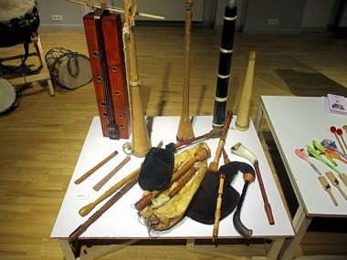

# Latvian Bagpipe and Folk Pipes

*Latvijas dūdas · Dūdas*

**Encyclopedia ID 1324** (permanent) · https://bpupadhyaya.github.io/world-heritage-games-site/games/1324-latvian-bagpipe-and-folk-pipes/

*Photo: Turaids, [CC BY-SA 4.0](https://creativecommons.org/licenses/by-sa/4.0/), [source on Wikimedia Commons](https://commons.wikimedia.org/wiki/File:Eduarda_Klints_d%C5%ABdas,_stabules,_taures_un_ragi.jpg)*

Hold the drone and play the chanter notes in time as phrases scroll in, adding stabules (whistle pipes) and horns for a village band.

## Heritage note

Part of the living heritage of Latvia.

## Origins

Usually placed in the era of Crossroads and Golden Ages (about 500 to 1500), although its exact origins are uncertain, within the cultural world of Northern and Eastern Europe.

## Facts

- **Where:** Latvia
- **Type:** Musical instruments
- **Family:** Wind instruments
- **Era:** [Crossroads and Golden Ages](../../eras/crossroads/index.md) (uncertain)
- **Cradle:** [Northern and Eastern Europe](../../cradles/north-east-europe/index.md)
- **Region:** Europe

## Related entries

- [Highland Bagpipe Chanter and Drone](../../games/510-highland-bagpipe-chanter-and-drone/index.md)
- [Horn of Africa camel caravan](../../games/1270-horn-of-africa-camel-caravan/index.md)
- [Mezoued Bagpipe and Tabl Drum](../../games/1336-mezoued-bagpipe-and-tabl-drum/index.md)
- [Fujara](../../games/135-fujara/index.md)
- [Novuss](../../games/456-novuss/index.md)
- [Kurai](../../games/1237-kurai/index.md)

## Sources

- <https://commons.wikimedia.org/wiki/File:Eduarda_Klints_d%C5%ABdas,_stabules,_taures_un_ragi.jpg>
