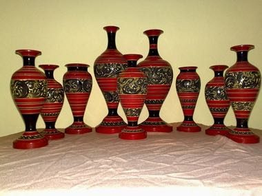

# Maldivian lacquer work

*ލިއެލާ ޖެހުން · liyelaa jehun*

**Encyclopedia ID 1328** (permanent) · https://equalinformation.com/world-heritage-games-site/games/1328-maldivian-lacquer-work/

*Photo: Donna, [CC0](https://creativecommons.org/publicdomain/zero/1.0/), [source on Wikimedia Commons](https://commons.wikimedia.org/wiki/File:Laquer-finished.jpg)*

Spin a wooden vase on a hand lathe, press on lacquer sticks in layers of red, black and yellow, then scrape back to reveal an engraved scroll pattern.

## Heritage note

Part of the living heritage of Maldives.

## Origins

A living tradition passed from person to person; it is not tied to a single dated origin. It belongs to the cultural world of South Asia.

## Facts

- **Where:** Maldives
- **Type:** Crafts and making
- **Family:** Pottery, wood and metal crafts
- **Era:** [Living Traditions](../../eras/living/index.md)
- **Cradle:** [South Asia](../../cradles/south-asia/index.md)
- **Region:** South and Central Asia

## Related entries

- [Jaipur blue pottery painting](../../games/262-jaipur-blue-pottery-painting/index.md)
- [Dhokra lost-wax casting](../../games/278-dhokra-lost-wax-casting/index.md)
- [Bankura terracotta horse](../../games/280-bankura-terracotta-horse/index.md)
- [Sholapith flower carving](../../games/283-sholapith-flower-carving/index.md)
- [Ambalangoda mask carving](../../games/299-ambalangoda-mask-carving/index.md)
- [Zellij tile mosaic](../../games/21-zellij-tile-mosaic/index.md)

## Sources

- <https://commons.wikimedia.org/wiki/File:Laquer-finished.jpg>
