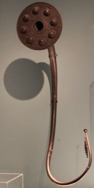

# Lur pitch-and-breath game

*lur · Bronze Age horn*

**Encyclopedia ID 1329** (permanent) · https://bpupadhyaya.github.io/world-heritage-games-site/games/1329-lur-pitch-and-breath-game/

*Photo: Anagoria, [CC BY 3.0](https://creativecommons.org/licenses/by/3.0/), [source on Wikimedia Commons](https://commons.wikimedia.org/wiki/File:-1300_Lure_Brudevaelte_anagoria.JPG)*

Blow into a pair of curved bronze horns, shaping pitch with breath pressure and lip tension to match falling notes in a melody.

## Heritage note

Part of the living heritage of Denmark. Some forms of this practice carry deep meaning for the communities who keep it; here we describe the play and the craft only, with respect for its roots.

## Origins

A living tradition passed from person to person; it is not tied to a single dated origin. It belongs to the cultural world of Northern and Eastern Europe.

## Facts

- **Where:** Denmark
- **Type:** Musical instruments
- **Family:** Wind instruments
- **Era:** [Living Traditions](../../eras/living/index.md)
- **Cradle:** [Northern and Eastern Europe](../../cradles/north-east-europe/index.md)
- **Region:** Europe

## Related entries

- [Trembita](../../games/1387-trembita/index.md)
- [Khene](../../games/145-khene/index.md)
- [Mijwiz Double Clarinet](../../games/221-mijwiz-double-clarinet/index.md)
- [Mudhif reed-arch house](../../games/230-mudhif-reed-arch-house/index.md)
- [Lusheng](../../games/337-lusheng/index.md)
- [Launeddas Triple Pipe](../../games/400-launeddas-triple-pipe/index.md)

## Sources

- <https://commons.wikimedia.org/wiki/File:-1300_Lure_Brudevaelte_anagoria.JPG>
