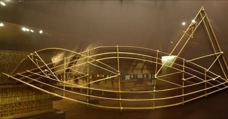

# Marshallese stick chart navigator

*Mattang / rebbelib · mattang*

**Encyclopedia ID 1333** (permanent) · https://bpupadhyaya.github.io/world-heritage-games-site/games/1333-marshallese-stick-chart-navigator/

*Photo: Daderot, [CC0](https://creativecommons.org/publicdomain/zero/1.0/), [source on Wikimedia Commons](https://commons.wikimedia.org/wiki/File:Stick_chart,_Marshall_Islands,_1898_-_S%C3%BCdseeabteilung_-_Ethnological_Museum,_Berlin_-_DSC00979.JPG)*

Read a lattice of sticks and shell islands to match the swell patterns and plot a canoe route between atolls.

## Heritage note

Part of the living heritage of Marshall Islands.

## Origins

Usually placed in the era of Modern Heritage (1800 to today), although its exact origins are uncertain, within the cultural world of Pacific and Oceania.

## Facts

- **Where:** Marshall Islands
- **Type:** Puzzles and mind games
- **Family:** Puzzle and dexterity toys
- **Era:** [Modern Heritage](../../eras/modern/index.md) (uncertain)
- **Cradle:** [Pacific and Oceania](../../cradles/pacific/index.md)
- **Region:** Oceania and Pacific

## Related entries

- [Sand drawing](../../games/1395-sand-drawing/index.md)
- [Maori stick games](../../games/981-maori-stick-games/index.md)
- [Heu](../../games/1146-heu/index.md)
- [Hiko](../../games/1147-hiko/index.md)
- [Kingyo-sukui](../../games/3-kingyo-sukui/index.md)
- [Stone Skipping](../../games/5-stone-skipping/index.md)

## Sources

- <https://commons.wikimedia.org/wiki/File:Stick_chart,_Marshall_Islands,_1898_-_S%C3%BCdseeabteilung_-_Ethnological_Museum,_Berlin_-_DSC00979.JPG>
