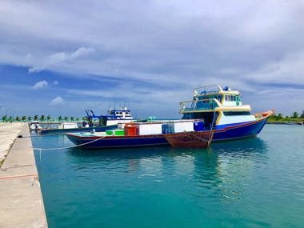

# Pole-and-line tuna fishing from a masdhoni

*މަސްދޯނި*

**Encyclopedia ID 1334** (permanent) · https://bpupadhyaya.github.io/world-heritage-games-site/games/1334-pole-and-line-tuna-fishing-from-a-masdhoni/

*Photo: Muammar1982, [CC BY-SA 4.0](https://creativecommons.org/licenses/by-sa/4.0/), [source on Wikimedia Commons](https://commons.wikimedia.org/wiki/File:Fishing_Boats,_Mathiveri,_Maldives.jpg)*

Chum the water with live bait, swing the barbless pole to flick a tuna aboard each time the school surfaces, keeping your rhythm and the bait stock up.

## Heritage note

Part of the living heritage of Maldives.

## Origins

Usually placed in the era of Modern Heritage (1800 to today), although its exact origins are uncertain, within the cultural world of South Asia.

## Facts

- **Where:** Maldives
- **Type:** Dexterity and skill games
- **Family:** Water sports
- **Era:** [Modern Heritage](../../eras/modern/index.md) (uncertain)
- **Cradle:** [South Asia](../../cradles/south-asia/index.md)
- **Region:** South and Central Asia

## Related entries

- [Netball](../../games/447-netball/index.md)
- [Haenyeo Breath Dive](../../games/1459-haenyeo-breath-dive/index.md)
- [Matkot](../../games/825-matkot/index.md)
- [Kataw](../../games/873-kataw/index.md)
- [Mixtec ball game](../../games/936-mixtec-ball-game/index.md)
- [Nouka Baich](../../games/42-nouka-baich/index.md)

## Sources

- <https://commons.wikimedia.org/wiki/File:Fishing_Boats,_Mathiveri,_Maldives.jpg>
