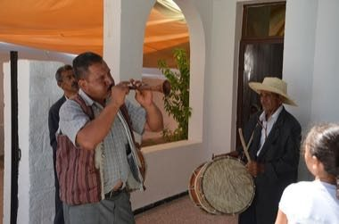

# Mezoued Bagpipe and Tabl Drum

*Mezoued / مزود*

**Encyclopedia ID 1336** (permanent) · https://bpupadhyaya.github.io/world-heritage-games-site/games/1336-mezoued-bagpipe-and-tabl-drum/

*Photo: Nizarkalech, [CC BY-SA 4.0](https://creativecommons.org/licenses/by-sa/4.0/), [source on Wikimedia Commons](https://commons.wikimedia.org/wiki/File:Mezoued_beja_01.jpg)*

Squeeze the goatskin bag, finger the two-reed pipe and answer the drummer on a call-and-response rhythm track.

## Heritage note

Part of the living heritage of Tunisia.

## Origins

Usually placed in the era of Crossroads and Golden Ages (about 500 to 1500), although its exact origins are uncertain, within the cultural world of Mediterranean.

## Facts

- **Where:** Tunisia
- **Type:** Musical instruments
- **Family:** Wind instruments
- **Era:** [Crossroads and Golden Ages](../../eras/crossroads/index.md) (uncertain)
- **Cradle:** [Mediterranean](../../cradles/mediterranean/index.md)
- **Region:** Middle East and North Africa

## Related entries

- [Highland Bagpipe Chanter and Drone](../../games/510-highland-bagpipe-chanter-and-drone/index.md)
- [Horn of Africa camel caravan](../../games/1270-horn-of-africa-camel-caravan/index.md)
- [Latvian Bagpipe and Folk Pipes](../../games/1324-latvian-bagpipe-and-folk-pipes/index.md)
- [Launeddas Triple Pipe](../../games/400-launeddas-triple-pipe/index.md)
- [Dizi](../../games/132-dizi/index.md)
- [Fujara](../../games/135-fujara/index.md)

## Sources

- <https://commons.wikimedia.org/wiki/File:Mezoued_beja_01.jpg>
