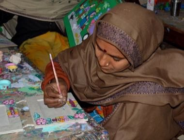

# Mithila folk painting

*Also known as: मिथिला कला · fish and peacock motifs*

**Encyclopedia ID 1337** (permanent) · https://bpupadhyaya.github.io/world-heritage-games-site/games/1337-mithila-folk-painting/

*Photo: Abhishek Singh from Kathmandu, Nepal, [CC BY-SA 2.0](https://creativecommons.org/licenses/by-sa/2.0/), [source on Wikimedia Commons](https://commons.wikimedia.org/wiki/File:Mithila_Painting_artist_-_Flickr_-_askmeaks.jpg)*

Fill bold outlined motifs (fish, peacock, sun, lotus pond, bamboo grove) with the classic bright flat colours and fine double-line borders, matching the traditional pattern rules to finish a panel.

## Heritage note

Part of the living heritage of Nepal, India. Some forms of this practice carry deep meaning for the communities who keep it; here we describe the play and the craft only, with respect for its roots.

## Origins

A living tradition passed from person to person; it is not tied to a single dated origin. It belongs to the cultural world of South Asia.

## Facts

- **Where:** Nepal, India
- **Type:** Crafts and making
- **Family:** Paper, ink and painting crafts
- **Era:** [Living Traditions](../../eras/living/index.md)
- **Cradle:** [South Asia](../../cradles/south-asia/index.md)
- **Region:** South and Central Asia

## Related entries

- [Pakistani truck art](../../games/116-pakistani-truck-art/index.md)
- [Warli painting](../../games/117-warli-painting/index.md)
- [Block printing](../../games/118-block-printing/index.md)
- [Lippan kaam mud-and-mirror relief](../../games/259-lippan-kaam-mud-and-mirror-relief/index.md)
- [Mehndi henna pattern drawing](../../games/260-mehndi-henna-pattern-drawing/index.md)
- [Kashmiri papier-mache painting](../../games/269-kashmiri-papier-mache-painting/index.md)

## Sources

- <https://commons.wikimedia.org/wiki/File:Mithila_Painting_artist_-_Flickr_-_askmeaks.jpg>
