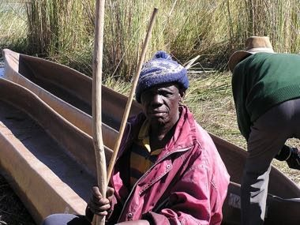

# Mokoro polling

*Also known as: Mokoro polling (Okavango dugout race) · Okavango dugout race*

**Encyclopedia ID 1338** (permanent) · https://bpupadhyaya.github.io/world-heritage-games-site/games/1338-mokoro-polling/

*Photo: No machine-readable author provided. DDD DDD~commonswiki assumed (based on copyright claims)., [Public domain](https://creativecommons.org/publicdomain/mark/1.0/), [source on Wikimedia Commons](https://commons.wikimedia.org/wiki/File:Mokoro_Polers_in_the_Okavango.jpg)*

Stand at the stern of a dugout canoe and pole it through reed channels, timing strokes left and right to keep a straight line and beat the clock.

## Heritage note

Part of the living heritage of Botswana.

## Origins

Usually placed in the era of Age of Contact and Craft (about 1500 to 1800), although its exact origins are uncertain, within the cultural world of Africa: Southern Africa.

## Facts

- **Where:** Botswana
- **Type:** Racing
- **Family:** Water sports
- **Era:** [Age of Contact and Craft](../../eras/contact/index.md) (uncertain)
- **Cradle:** [Africa: Southern Africa](../../cradles/africa-south/index.md)
- **Region:** Sub-Saharan Africa

## Related entries

- [Nouka Baich](../../games/42-nouka-baich/index.md)
- [Pirogue coastal canoe race](../../games/56-pirogue-coastal-canoe-race/index.md)
- [Nile Felucca Sailing](../../games/216-nile-felucca-sailing/index.md)
- [Shikara paddle race](../../games/265-shikara-paddle-race/index.md)
- [Hanetsuki](../../games/347-hanetsuki/index.md)
- [Venetian lagoon regatta](../../games/486-venetian-lagoon-regatta/index.md)

## Sources

- <https://commons.wikimedia.org/wiki/File:Mokoro_Polers_in_the_Okavango.jpg>
