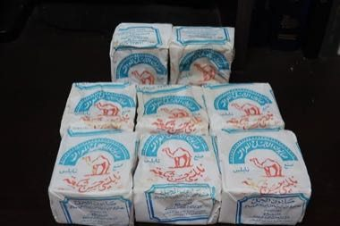

# Nabulsi Soap Tower

*Sabun Nabulsi / صابون نابلسي*

**Encyclopedia ID 1341** (permanent) · https://equalinformation.com/world-heritage-games-site/games/1341-nabulsi-soap-tower/

*Photo: Davidbena, [CC BY-SA 4.0](https://creativecommons.org/licenses/by-sa/4.0/), [source on Wikimedia Commons](https://commons.wikimedia.org/wiki/File:Nabulsi_soap.jpg)*

Cut cooled olive-oil soap slabs into cubes, stamp each, then stack them into airy cones and towers so air flows and nothing falls, over weeks of drying.

## Heritage note

Part of the living heritage of Palestine.

## Origins

A living tradition passed from person to person; it is not tied to a single dated origin. It belongs to the cultural world of Mesopotamia, Levant and Arabia.

## Facts

- **Where:** Palestine
- **Type:** Crafts and making
- **Era:** [Living Traditions](../../eras/living/index.md)
- **Cradle:** [Mesopotamia, Levant and Arabia](../../cradles/mesopotamia-levant/index.md)
- **Region:** Middle East and North Africa

## Related entries

- [Tatreez Palestinian Cross-Stitch](../../games/212-tatreez-palestinian-cross-stitch/index.md)
- [Mijwiz Double Clarinet](../../games/221-mijwiz-double-clarinet/index.md)
- [Keffiyeh Pattern Loom](../../games/1310-keffiyeh-pattern-loom/index.md)
- [Ebru paper marbling](../../games/20-ebru-paper-marbling/index.md)
- [Dabke line dance](../../games/37-dabke-line-dance/index.md)
- [Jordanian Sand Bottle Art](../../games/219-jordanian-sand-bottle-art/index.md)

## Sources

- <https://commons.wikimedia.org/wiki/File:Nabulsi_soap.jpg>
