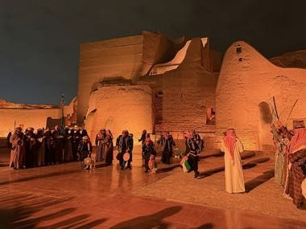

# Ardah Drum-and-Line Rhythm

*Also known as: العرضة*

**Encyclopedia ID 1343** (permanent) · https://bpupadhyaya.github.io/world-heritage-games-site/games/1343-ardah-drum-and-line-rhythm/

*Photo: Ahad.F, [CC BY-SA 4.0](https://creativecommons.org/licenses/by-sa/4.0/), [source on Wikimedia Commons](https://commons.wikimedia.org/wiki/File:Saudi_Ardha_(Najdi_Sword_Dance)_in_At-Turaif_district,_Diriyah,_Saudi_Arabia.jpg)*

staying on the beat grows the line.

## Heritage note

Part of the living heritage of Saudi Arabia. Some forms of this practice carry deep meaning for the communities who keep it; here we describe the play and the craft only, with respect for its roots. It is presented as sport and skill, never as real fighting.

## Origins

A living tradition passed from person to person; it is not tied to a single dated origin. It belongs to the cultural world of Mesopotamia, Levant and Arabia.

## Facts

- **Where:** Saudi Arabia
- **Type:** Musical instruments
- **Family:** Drums and percussion
- **Era:** [Living Traditions](../../eras/living/index.md)
- **Cradle:** [Mesopotamia, Levant and Arabia](../../cradles/mesopotamia-levant/index.md)
- **Region:** Middle East and North Africa

## Related entries

- [Talking drum](../../games/33-talking-drum/index.md)
- [Tabla Bol Rhythm](../../games/35-tabla-bol-rhythm/index.md)
- [Marimba](../../games/52-marimba/index.md)
- [Calabash Water Drum](../../games/180-calabash-water-drum/index.md)
- [Amadinda and embaire](../../games/185-amadinda-and-embaire/index.md)
- [Isukuti drum dance](../../games/191-isukuti-drum-dance/index.md)

## Sources

- <https://commons.wikimedia.org/wiki/File:Saudi_Ardha_(Najdi_Sword_Dance)_in_At-Turaif_district,_Diriyah,_Saudi_Arabia.jpg>
