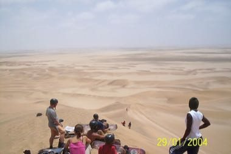

# Namib dune sandboarding

*Namib dune sandboarding*

**Encyclopedia ID 1345** (permanent) · https://bpupadhyaya.github.io/world-heritage-games-site/games/1345-namib-dune-sandboarding/

*Photo: Katie Hunt from St Albans, UK, [CC BY 2.0](https://creativecommons.org/licenses/by/2.0/), [source on Wikimedia Commons](https://commons.wikimedia.org/wiki/File:Sandboarding,_Swakopmund_(5832930423).jpg)*

Lean to carve down tall dunes on a board, link turns, collect boost flags and avoid rocks to reach the bottom in time.

## Heritage note

Part of the living heritage of Namibia.

## Origins

Usually placed in the era of Modern Heritage (1800 to today), although its exact origins are uncertain, within the cultural world of Africa: Southern Africa.

## Facts

- **Where:** Namibia
- **Type:** Dexterity and skill games
- **Family:** Winter sports
- **Era:** [Modern Heritage](../../eras/modern/index.md) (uncertain)
- **Cradle:** [Africa: Southern Africa](../../cradles/africa-south/index.md)
- **Region:** Sub-Saharan Africa

## Related entries

- [Nguni stick-fighting rhythm skirmish](../../games/209-nguni-stick-fighting-rhythm-skirmish/index.md)
- [Koi](../../games/599-koi/index.md)
- [Chinlone](../../games/16-chinlone/index.md)
- [Pinata swing](../../games/61-pinata-swing/index.md)
- [Ring Tilting](../../games/65-ring-tilting/index.md)
- [Yukigassen Snow Fort](../../games/71-yukigassen-snow-fort/index.md)

## Sources

- <https://commons.wikimedia.org/wiki/File:Sandboarding,_Swakopmund_(5832930423).jpg>
