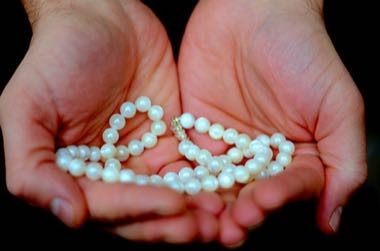

# Ohrid Pearl Maker

*Also known as: Охридски бисер*

**Encyclopedia ID 1350** (permanent) · https://bpupadhyaya.github.io/world-heritage-games-site/games/1350-ohrid-pearl-maker/

*Photo: Slavica Panova, [CC BY-SA 3.0](https://creativecommons.org/licenses/by-sa/3.0/), [source on Wikimedia Commons](https://commons.wikimedia.org/wiki/File:Ohridski_biser_01.JPG)*

Layer thin nacre shavings over a bead core, polish and thread strands to match an order sheet; the glossy result is judged on evenness.

## Heritage note

Part of the living heritage of North Macedonia.

## Origins

A living tradition passed from person to person; it is not tied to a single dated origin. It belongs to the cultural world of Mediterranean.

## Facts

- **Where:** North Macedonia
- **Type:** Crafts and making
- **Era:** [Living Traditions](../../eras/living/index.md)
- **Cradle:** [Mediterranean](../../cradles/mediterranean/index.md)
- **Region:** Europe

## Related entries

- [Zellij tile mosaic](../../games/21-zellij-tile-mosaic/index.md)
- [Glassblowing](../../games/121-glassblowing/index.md)
- [Azulejo tile painting](../../games/122-azulejo-tile-painting/index.md)
- [Lefkara Lace](../../games/220-lefkara-lace/index.md)
- [Amazigh Rug Weaving](../../games/224-amazigh-rug-weaving/index.md)
- [Macau wave pavement](../../games/372-macau-wave-pavement/index.md)

## Sources

- <https://commons.wikimedia.org/wiki/File:Ohridski_biser_01.JPG>
