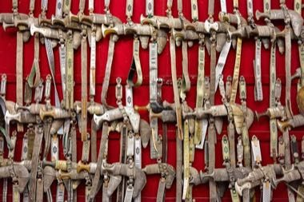

# Omani Khanjar Silver Filigree

*Also known as: خنجر عماني*

**Encyclopedia ID 1351** (permanent) · https://bpupadhyaya.github.io/world-heritage-games-site/games/1351-omani-khanjar-silver-filigree/

*Photo: Richard Bartz, [CC BY-SA 3.0](https://creativecommons.org/licenses/by-sa/3.0/), [source on Wikimedia Commons](https://commons.wikimedia.org/wiki/File:Oman_Khanjar.jpg)*

Twist, coil and solder silver wire into the braided 'kabaa' sheath patterns, following a pattern card and managing heat and tension.

## Heritage note

Part of the living heritage of Oman. It is presented as sport and skill, never as real fighting.

## Origins

A living tradition passed from person to person; it is not tied to a single dated origin. It belongs to the cultural world of Mesopotamia, Levant and Arabia.

## Facts

- **Where:** Oman
- **Type:** Crafts and making
- **Family:** Pottery, wood and metal crafts
- **Era:** [Living Traditions](../../eras/living/index.md)
- **Cradle:** [Mesopotamia, Levant and Arabia](../../cradles/mesopotamia-levant/index.md)
- **Region:** Middle East and North Africa

## Related entries

- [Damascus Mother-of-Pearl Inlay](../../games/223-damascus-mother-of-pearl-inlay/index.md)
- [Iznik tile painting](../../games/244-iznik-tile-painting/index.md)
- [Zellij tile mosaic](../../games/21-zellij-tile-mosaic/index.md)
- [Swahili carved door](../../games/90-swahili-carved-door/index.md)
- [Thai fruit and vegetable carving](../../games/114-thai-fruit-and-vegetable-carving/index.md)
- [Glassblowing](../../games/121-glassblowing/index.md)

## Sources

- <https://commons.wikimedia.org/wiki/File:Oman_Khanjar.jpg>
