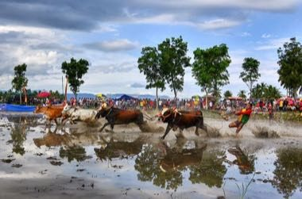

# Pacu jawi

*Also known as: rice-field bull race*

**Encyclopedia ID 1354** (permanent) · https://bpupadhyaya.github.io/world-heritage-games-site/games/1354-pacu-jawi/

*Photo: Deni Dahniel, [CC BY-SA 4.0](https://creativecommons.org/licenses/by-sa/4.0/), [source on Wikimedia Commons](https://commons.wikimedia.org/wiki/File:Olah_Raga_Tradisi_Pacu_Jawi.jpg)*

Steer a pair of bulls through a flooded rice field by holding on, steering with tail pressure and keeping a straight line to the finish pole.

## Heritage note

Part of the living heritage of Indonesia. Some forms of this practice carry deep meaning for the communities who keep it; here we describe the play and the craft only, with respect for its roots. Animals are partners in this tradition; good care and local rules always come first.

## Origins

Usually placed in the era of Age of Contact and Craft (about 1500 to 1800), although its exact origins are uncertain, within the cultural world of Southeast Asia and the Islands.

## Facts

- **Where:** Indonesia
- **Type:** Racing
- **Family:** Horse and animal sports
- **Era:** [Age of Contact and Craft](../../eras/contact/index.md) (uncertain)
- **Cradle:** [Southeast Asia and the Islands](../../cradles/southeast-asia/index.md)
- **Region:** East and Southeast Asia

## Related entries

- [Madura bull racing](../../games/805-madura-bull-racing/index.md)
- [Regional pub games](../../games/1180-regional-pub-games/index.md)
- [Bakiak](../../games/324-bakiak/index.md)
- [Independence-day field games](../../games/330-independence-day-field-games/index.md)
- [Sack Race](../../games/476-sack-race/index.md)
- [Encang kuda](../../games/1067-encang-kuda/index.md)

## Sources

- <https://commons.wikimedia.org/wiki/File:Olah_Raga_Tradisi_Pacu_Jawi.jpg>
