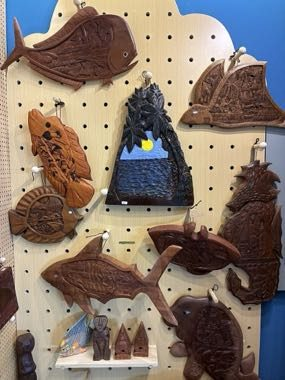

# Palauan storyboard carving

*Storyboards (dechel / bai)*

**Encyclopedia ID 1355** (permanent) · https://equalinformation.com/world-heritage-games-site/games/1355-palauan-storyboard-carving/

*Photo: Zykasaa, [CC BY 4.0](https://creativecommons.org/licenses/by/4.0/), [source on Wikimedia Commons](https://commons.wikimedia.org/wiki/File:Storyboards_in_Palau_Airport.jpg)*

Arrange carved tiles and scenes into a legend panel, matching pictures to story steps and etching in scene details.

## Heritage note

Part of the living heritage of Palau.

## Origins

A living tradition passed from person to person; it is not tied to a single dated origin. It belongs to the cultural world of Pacific and Oceania.

## Facts

- **Where:** Palau
- **Type:** Crafts and making
- **Family:** Pottery, wood and metal crafts
- **Era:** [Living Traditions](../../eras/living/index.md)
- **Cradle:** [Pacific and Oceania](../../cradles/pacific/index.md)
- **Region:** Oceania and Pacific

## Related entries

- [Valley Tonga coil pottery](../../games/1384-valley-tonga-coil-pottery/index.md)
- [Zellij tile mosaic](../../games/21-zellij-tile-mosaic/index.md)
- [Swahili carved door](../../games/90-swahili-carved-door/index.md)
- [Thai fruit and vegetable carving](../../games/114-thai-fruit-and-vegetable-carving/index.md)
- [Glassblowing](../../games/121-glassblowing/index.md)
- [Azulejo tile painting](../../games/122-azulejo-tile-painting/index.md)

## Sources

- <https://commons.wikimedia.org/wiki/File:Storyboards_in_Palau_Airport.jpg>
