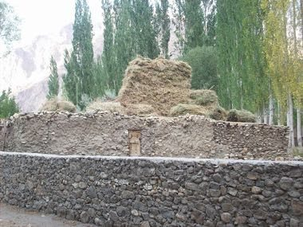

# Pamiri House Ceiling Raiser

*Чод / Chorkhona*

**Encyclopedia ID 1356** (permanent) · https://bpupadhyaya.github.io/world-heritage-games-site/games/1356-pamiri-house-ceiling-raiser/

*Photo: Zack Knowles, [CC BY-SA 3.0](https://creativecommons.org/licenses/by-sa/3.0/), [source on Wikimedia Commons](https://commons.wikimedia.org/wiki/File:Pamiri_house_-_panoramio.jpg)*

Stack five nested square wooden tiers on four pillars to form the Pamiri roof lantern and match a hearth-and-sleeping-platform layout.

## Heritage note

Part of the living heritage of Tajikistan. Some forms of this practice carry deep meaning for the communities who keep it; here we describe the play and the craft only, with respect for its roots.

## Origins

A living tradition passed from person to person; it is not tied to a single dated origin. It belongs to the cultural world of Persia, Caucasus and Central Asia.

## Facts

- **Where:** Tajikistan
- **Type:** Crafts and making
- **Family:** Pottery, wood and metal crafts
- **Era:** [Living Traditions](../../eras/living/index.md)
- **Cradle:** [Persia, Caucasus and Central Asia](../../cradles/persia-central-asia/index.md)
- **Region:** South and Central Asia

## Related entries

- [Khatam inlay star pattern workshop](../../games/231-khatam-inlay-star-pattern-workshop/index.md)
- [Rishtan ceramics](../../games/252-rishtan-ceramics/index.md)
- [Turkmen Silver Jewelry Designer](../../games/1392-turkmen-silver-jewelry-designer/index.md)
- [Zellij tile mosaic](../../games/21-zellij-tile-mosaic/index.md)
- [Swahili carved door](../../games/90-swahili-carved-door/index.md)
- [Thai fruit and vegetable carving](../../games/114-thai-fruit-and-vegetable-carving/index.md)

## Sources

- <https://commons.wikimedia.org/wiki/File:Pamiri_house_-_panoramio.jpg>
