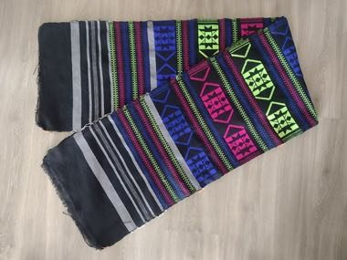

# Panu di Pinti Weaving

*Panu di pinti (pano de pente)*

**Encyclopedia ID 1357** (permanent) · https://equalinformation.com/world-heritage-games-site/games/1357-panu-di-pinti-weaving/

*Photo: Sfs90, [CC BY-SA 4.0](https://creativecommons.org/licenses/by-sa/4.0/), [source on Wikimedia Commons](https://commons.wikimedia.org/wiki/File:Panu_di_pinti_(1).jpg)*

Weave narrow strips of dark and bright cotton with supplementary-weft geometric motifs, then arrange strips into a cloth matching the pattern.

## Heritage note

Part of the living heritage of Guinea-Bissau. Some forms of this practice carry deep meaning for the communities who keep it; here we describe the play and the craft only, with respect for its roots.

## Origins

A living tradition passed from person to person; it is not tied to a single dated origin. It belongs to the cultural world of Africa: Sahel, West and Central.

## Facts

- **Where:** Guinea-Bissau
- **Type:** Crafts and making
- **Family:** Textile and weaving crafts
- **Era:** [Living Traditions](../../eras/living/index.md)
- **Cradle:** [Africa: Sahel, West and Central](../../cradles/africa-west/index.md)
- **Region:** Sub-Saharan Africa

## Related entries

- [Kente strip weaving](../../games/22-kente-strip-weaving/index.md)
- [Adire indigo resist dyeing](../../games/87-adire-indigo-resist-dyeing/index.md)
- [Bolga Basket Weaver](../../games/1245-bolga-basket-weaver/index.md)
- [Faso Dan Fani Strip Weaving](../../games/1277-faso-dan-fani-strip-weaving/index.md)
- [Celtic knot weave](../../games/25-celtic-knot-weave/index.md)
- [Sashiko Stitch Patterns](../../games/27-sashiko-stitch-patterns/index.md)

## Sources

- <https://commons.wikimedia.org/wiki/File:Panu_di_pinti_(1).jpg>
