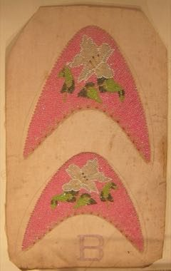

# Peranakan beaded slippers

*kasut manik*

**Encyclopedia ID 1358** (permanent) · https://bpupadhyaya.github.io/world-heritage-games-site/games/1358-peranakan-beaded-slippers/

*Photo: Hiart, [CC0](https://creativecommons.org/publicdomain/zero/1.0/), [source on Wikimedia Commons](https://commons.wikimedia.org/wiki/File:Munka_kasot,_Peranakan,_early_20th_century_beaded_uppers_for_pair_of_slippers,_Intan.JPG)*

Thread tiny glass beads onto a printed canvas grid in cross-stitch style, copying a floral motif colour by colour to finish a slipper upper.

## Heritage note

Part of the living heritage of China, Singapore.

## Origins

A living tradition passed from person to person; it is not tied to a single dated origin. It belongs to the cultural world of China.

## Facts

- **Where:** China, Singapore
- **Type:** Crafts and making
- **Family:** Paper, ink and painting crafts
- **Era:** [Living Traditions](../../eras/living/index.md)
- **Cradle:** [China](../../cradles/china/index.md)
- **Region:** East and Southeast Asia

## Related entries

- [Chinese knotting](../../games/26-chinese-knotting/index.md)
- [Cloisonne](../../games/343-cloisonne/index.md)
- [Oil-paper umbrella making](../../games/344-oil-paper-umbrella-making/index.md)
- [Cheongsam Tailor Shop](../../games/1462-cheongsam-tailor-shop/index.md)
- [Ebru paper marbling](../../games/20-ebru-paper-marbling/index.md)
- [Ndebele geometric wall painting](../../games/23-ndebele-geometric-wall-painting/index.md)

## Sources

- <https://commons.wikimedia.org/wiki/File:Munka_kasot,_Peranakan,_early_20th_century_beaded_uppers_for_pair_of_slippers,_Intan.JPG>
