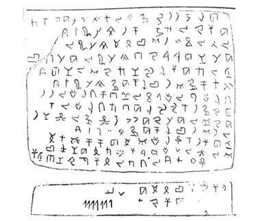

# Phoenician Alphabet Trader

*Abjad / أبجدية*

**Encyclopedia ID 1359** (permanent) · https://bpupadhyaya.github.io/world-heritage-games-site/games/1359-phoenician-alphabet-trader/

*Photo: Unknown authorUnknown author, [Public domain](https://creativecommons.org/publicdomain/mark/1.0/), [source on Wikimedia Commons](https://commons.wikimedia.org/wiki/File:Phoenician_alphabet_as_was_discovered_in_Byblos.png)*

Trade by writing short bills of lading in 22 letters, matching letter shapes to sounds before ships sail with goods.

## Heritage note

Part of the living heritage of Lebanon. Some forms of this practice carry deep meaning for the communities who keep it; here we describe the play and the craft only, with respect for its roots.

## Origins

Usually placed in the era of Modern Heritage (1800 to today), although its exact origins are uncertain, within the cultural world of Mesopotamia, Levant and Arabia.

## Facts

- **Where:** Lebanon
- **Type:** Puzzles and mind games
- **Family:** Puzzle and dexterity toys
- **Era:** [Modern Heritage](../../eras/modern/index.md) (uncertain)
- **Cradle:** [Mesopotamia, Levant and Arabia](../../cradles/mesopotamia-levant/index.md)
- **Region:** Middle East and North Africa

## Related entries

- [Al-Jazari water-clock contraptions](../../games/237-al-jazari-water-clock-contraptions/index.md)
- [Hama Noria Waterwheels](../../games/1295-hama-noria-waterwheels/index.md)
- [Kingyo-sukui](../../games/3-kingyo-sukui/index.md)
- [Stone Skipping](../../games/5-stone-skipping/index.md)
- [Disc-flip](../../games/8-disc-flip/index.md)
- [Sjoelen](../../games/9-sjoelen/index.md)

## Sources

- <https://commons.wikimedia.org/wiki/File:Phoenician_alphabet_as_was_discovered_in_Byblos.png>
