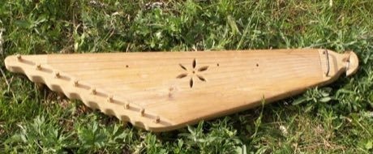

# Kanklės

*Kanklės · Baltic Zither*

**Encyclopedia ID 136** (permanent) · https://equalinformation.com/world-heritage-games-site/games/136-kankles/

*Photo: b.gliwa, [CC BY-SA 2.5](https://creativecommons.org/licenses/by-sa/2.5/), [source on Wikimedia Commons](https://commons.wikimedia.org/wiki/File:Kankles.jpg)*

Pluck and sweep the strings of a lap zither shown from above; follow lit strings to play folk melodies and the layered 'sutartinės' canon songs.

## Heritage note

Part of the living heritage of Lithuania. Some forms of this practice carry deep meaning for the communities who keep it; here we describe the play and the craft only, with respect for its roots.

## Origins

Usually placed in the era of Classical Worlds (about 1000 BCE to 500 CE), although its exact origins are uncertain, within the cultural world of Northern and Eastern Europe.

## Facts

- **Where:** Lithuania
- **Type:** Musical instruments
- **Family:** String instruments
- **Era:** [Classical Worlds](../../eras/classical/index.md) (uncertain)
- **Cradle:** [Northern and Eastern Europe](../../cradles/north-east-europe/index.md)
- **Region:** Europe

## Related entries

- [Kantele](../../games/152-kantele/index.md)
- [Nyckelharpa](../../games/408-nyckelharpa/index.md)
- [Langeleik](../../games/1322-langeleik/index.md)
- [Morin khuur](../../games/34-morin-khuur/index.md)
- [Kathputli string puppets](../../games/79-kathputli-string-puppets/index.md)
- [Valiha tube zither](../../games/124-valiha-tube-zither/index.md)

## Sources

- <https://commons.wikimedia.org/wiki/File:Kankles.jpg>
