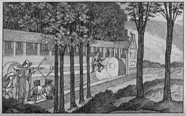

# Crossbow Target Match

*Balestra sammarinese · balestra*

**Encyclopedia ID 1367** (permanent) · https://equalinformation.com/world-heritage-games-site/games/1367-crossbow-target-match/

*Photo: Wellcome Collection (generic crossbow-target etching; no San Marino photo found), [CC BY 4.0](https://creativecommons.org/licenses/by/4.0/), [source on Wikimedia Commons](https://commons.wikimedia.org/wiki/File:Men_shooting_at_a_target_with_crossbows._Etching._Wellcome_V0040445.jpg)*

Wind the crossbow, steady the sight against wind and wobble, and loose one bolt per round at a distant bullseye in a head-to-head match.

## Heritage note

Part of the living heritage of Italy, San Marino. It is presented as sport and skill, never as real fighting.

## Origins

Usually placed in the era of Modern Heritage (1800 to today), although its exact origins are uncertain, within the cultural world of Mediterranean.

## Facts

- **Where:** Italy, San Marino
- **Type:** Dexterity and skill games
- **Family:** Winter sports
- **Era:** [Modern Heritage](../../eras/modern/index.md) (uncertain)
- **Cradle:** [Mediterranean](../../cradles/mediterranean/index.md)
- **Region:** Europe

## Related entries

- [Gondola Rowing](../../games/401-gondola-rowing/index.md)
- [Ring Tilting](../../games/65-ring-tilting/index.md)
- [Chinlone](../../games/16-chinlone/index.md)
- [Pinata swing](../../games/61-pinata-swing/index.md)
- [Yukigassen Snow Fort](../../games/71-yukigassen-snow-fort/index.md)
- [Bagatelle](../../games/72-bagatelle/index.md)

## Sources

- <https://commons.wikimedia.org/wiki/File:Men_shooting_at_a_target_with_crossbows._Etching._Wellcome_V0040445.jpg>
