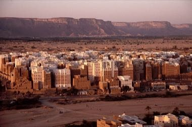

# Shibam Mud-Brick Tower Builder

*شبام حضرموت*

**Encyclopedia ID 1370** (permanent) · https://bpupadhyaya.github.io/world-heritage-games-site/games/1370-shibam-mud-brick-tower-builder/

*Photo: Jialiang Gao www.peace-on-earth.org [dead link], [CC BY-SA 3.0](https://creativecommons.org/licenses/by-sa/3.0/), [source on Wikimedia Commons](https://commons.wikimedia.org/wiki/File:Shibam_Wadi_Hadhramaut_Yemen.jpg)*

Stack and plaster sun-dried mud-brick storeys into a tall, narrow tower house, balancing wall thickness, floor load and window placement against rain, wind and a growing city grid.

## Heritage note

Part of the living heritage of Yemen.

## Origins

A living tradition passed from person to person; it is not tied to a single dated origin. It belongs to the cultural world of Mesopotamia, Levant and Arabia.

## Facts

- **Where:** Yemen
- **Type:** Crafts and making
- **Era:** [Living Traditions](../../eras/living/index.md)
- **Cradle:** [Mesopotamia, Levant and Arabia](../../cradles/mesopotamia-levant/index.md)
- **Region:** Middle East and North Africa

## Related entries

- [Qamariya Gypsum Window Designer](../../games/1368-qamariya-gypsum-window-designer/index.md)
- [Ebru paper marbling](../../games/20-ebru-paper-marbling/index.md)
- [Dabke line dance](../../games/37-dabke-line-dance/index.md)
- [Tatreez Palestinian Cross-Stitch](../../games/212-tatreez-palestinian-cross-stitch/index.md)
- [Jordanian Sand Bottle Art](../../games/219-jordanian-sand-bottle-art/index.md)
- [Mijwiz Double Clarinet](../../games/221-mijwiz-double-clarinet/index.md)

## Sources

- <https://commons.wikimedia.org/wiki/File:Shibam_Wadi_Hadhramaut_Yemen.jpg>
