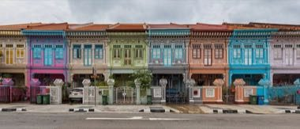

# Shophouse facade builder

**Encyclopedia ID 1373** (permanent) · https://equalinformation.com/world-heritage-games-site/games/1373-shophouse-facade-builder/

*Photo: Basile Morin, [CC BY-SA 4.0](https://creativecommons.org/licenses/by-sa/4.0/), [source on Wikimedia Commons](https://commons.wikimedia.org/wiki/File:Colorful_shophouses_in_Koon_Seng_Road,_Singapore.jpg)*

Assemble a five-foot-way shophouse front from tiles, louvred shutters, pintu pagar gates and plaster ornaments in matching pastel palettes to satisfy a street's heritage brief.

## Heritage note

Part of the living heritage of Singapore, China, Malaysia. Some forms of this practice carry deep meaning for the communities who keep it; here we describe the play and the craft only, with respect for its roots.

## Origins

A living tradition passed from person to person; it is not tied to a single dated origin. It belongs to the cultural world of Southeast Asia and the Islands.

## Facts

- **Where:** Singapore, China, Malaysia
- **Type:** Crafts and making
- **Family:** Pottery, wood and metal crafts
- **Era:** [Living Traditions](../../eras/living/index.md)
- **Cradle:** [Southeast Asia and the Islands](../../cradles/southeast-asia/index.md)
- **Region:** East and Southeast Asia

## Related entries

- [Thai fruit and vegetable carving](../../games/114-thai-fruit-and-vegetable-carving/index.md)
- [Burmese lacquerware engraving](../../games/310-burmese-lacquerware-engraving/index.md)
- [Zellij tile mosaic](../../games/21-zellij-tile-mosaic/index.md)
- [Swahili carved door](../../games/90-swahili-carved-door/index.md)
- [Glassblowing](../../games/121-glassblowing/index.md)
- [Azulejo tile painting](../../games/122-azulejo-tile-painting/index.md)

## Sources

- <https://commons.wikimedia.org/wiki/File:Colorful_shophouses_in_Koon_Seng_Road,_Singapore.jpg>
