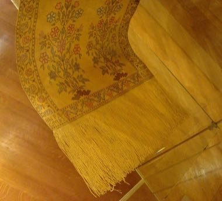

# Slutsk Sash Weaving

*Слуцкія паясы*

**Encyclopedia ID 1375** (permanent) · https://equalinformation.com/world-heritage-games-site/games/1375-slutsk-sash-weaving/

*Photo: master craftsman Leo Madjarski, [Public domain](https://creativecommons.org/publicdomain/mark/1.0/), [source on Wikimedia Commons](https://commons.wikimedia.org/wiki/File:Slutsk_belt_-_by_master_craftsman_Leo_Madjarski_-_cyrillic_script_-_Belarus_-_1780s_AD.jpg)*

Arrange floral and stripe motifs on a long two-sided silk sash, then flip it to see the inverse colour scheme created by the weave.

## Heritage note

Part of the living heritage of Belarus.

## Origins

A living tradition passed from person to person; it is not tied to a single dated origin. It belongs to the cultural world of Northern and Eastern Europe.

## Facts

- **Where:** Belarus
- **Type:** Crafts and making
- **Family:** Textile and weaving crafts
- **Era:** [Living Traditions](../../eras/living/index.md)
- **Cradle:** [Northern and Eastern Europe](../../cradles/north-east-europe/index.md)
- **Region:** Europe

## Related entries

- [Belarusian straw weaving](../../games/387-belarusian-straw-weaving/index.md)
- [Cross-Stitch Pattern Weaving](../../games/103-cross-stitch-pattern-weaving/index.md)
- [Haapsalu lace shawl knitting](../../games/386-haapsalu-lace-shawl-knitting/index.md)
- [Hardanger embroidery](../../games/1296-hardanger-embroidery/index.md)
- [Lielvārde Sash Pattern Weaving](../../games/1327-lielvarde-sash-pattern-weaving/index.md)
- [Moldovan Woven Carpet Pattern Studio](../../games/1339-moldovan-woven-carpet-pattern-studio/index.md)

## Sources

- <https://commons.wikimedia.org/wiki/File:Slutsk_belt_-_by_master_craftsman_Leo_Madjarski_-_cyrillic_script_-_Belarus_-_1780s_AD.jpg>
