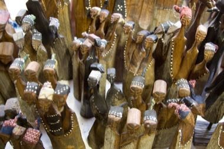

# Swazi carved figures and craft market

**Encyclopedia ID 1377** (permanent) · https://bpupadhyaya.github.io/world-heritage-games-site/games/1377-swazi-carved-figures-and-craft-market/

*Photo: Heather Dowd from Singapore, Singapore, [Public domain](https://creativecommons.org/publicdomain/mark/1.0/), [source on Wikimedia Commons](https://commons.wikimedia.org/wiki/File:Crafts_in_Eswatini.jpg)*

Carve small wooden figures with beaded details, set them out in a craft-market stall and serve customers who want particular styles.

## Heritage note

Part of the living heritage of Eswatini. Some forms of this practice carry deep meaning for the communities who keep it; here we describe the play and the craft only, with respect for its roots.

## Origins

A living tradition passed from person to person; it is not tied to a single dated origin. It belongs to the cultural world of Africa: Southern Africa.

## Facts

- **Where:** Eswatini
- **Type:** Crafts and making
- **Family:** Pottery, wood and metal crafts
- **Era:** [Living Traditions](../../eras/living/index.md)
- **Cradle:** [Africa: Southern Africa](../../cradles/africa-south/index.md)
- **Region:** Sub-Saharan Africa

## Related entries

- [Zellij tile mosaic](../../games/21-zellij-tile-mosaic/index.md)
- [Thai fruit and vegetable carving](../../games/114-thai-fruit-and-vegetable-carving/index.md)
- [Glassblowing](../../games/121-glassblowing/index.md)
- [Azulejo tile painting](../../games/122-azulejo-tile-painting/index.md)
- [Krobo Powder-Glass Beads](../../games/173-krobo-powder-glass-beads/index.md)
- [Lost-Wax Bronze Casting](../../games/178-lost-wax-bronze-casting/index.md)

## Sources

- <https://commons.wikimedia.org/wiki/File:Crafts_in_Eswatini.jpg>
