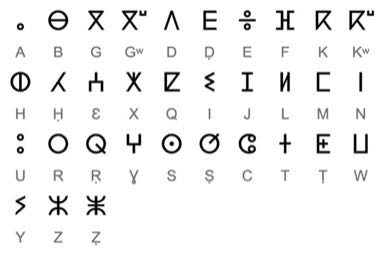

# Tifinagh Letter Puzzle

*Also known as: Tifinagh · ⵜⵉⴼⵉⵏⴰⵖ*

**Encyclopedia ID 1380** (permanent) · https://bpupadhyaya.github.io/world-heritage-games-site/games/1380-tifinagh-letter-puzzle/

*Photo: Serg!o, CC BY 2.0 es, [source on Wikimedia Commons](https://commons.wikimedia.org/wiki/File:Tifinagh_alphabet.png)*

Match geometric Tifinagh signs to sounds, then assemble short place and everyday words, finally carving them on a rock slab.

## Heritage note

Part of the living heritage of Niger, Morocco, Libya. Some forms of this practice carry deep meaning for the communities who keep it; here we describe the play and the craft only, with respect for its roots.

## Origins

Usually placed in the era of Age of Contact and Craft (about 1500 to 1800), although its exact origins are uncertain, within the cultural world of Africa: Sahel, West and Central.

## Facts

- **Where:** Niger, Morocco, Libya, Algeria
- **Type:** Puzzles and mind games
- **Family:** Puzzle and dexterity toys
- **Era:** [Age of Contact and Craft](../../eras/contact/index.md) (uncertain)
- **Cradle:** [Africa: Sahel, West and Central](../../cradles/africa-west/index.md)
- **Region:** Sub-Saharan Africa

## Related entries

- [Charro lasso roping](../../games/60-charro-lasso-roping/index.md)
- [Fukuwarai](../../games/94-fukuwarai/index.md)
- [Sangaku Geometry Puzzles](../../games/109-sangaku-geometry-puzzles/index.md)
- [Lo Shu Magic Square](../../games/111-lo-shu-magic-square/index.md)
- [Bozo Net Casting](../../games/169-bozo-net-casting/index.md)
- [Intha leg rowing on the lake](../../games/304-intha-leg-rowing-on-the-lake/index.md)

## Sources

- <https://commons.wikimedia.org/wiki/File:Tifinagh_alphabet.png>
