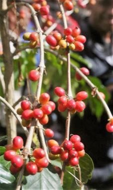

# Timorese coffee cherry harvest and sort

*kafé Timor-Leste*

**Encyclopedia ID 1381** (permanent) · https://equalinformation.com/world-heritage-games-site/games/1381-timorese-coffee-cherry-harvest-and-sort/

*Photo: GAB MEMAP, Ministro de Estado e Ministro da Agricultura e Pescas, [Public domain](https://creativecommons.org/publicdomain/mark/1.0/), [source on Wikimedia Commons](https://commons.wikimedia.org/wiki/File:2015-08-12_Kaffee_in_Maubisse_2.jpg)*

Pick only ripe red cherries, pulp, dry on the raised bed and sort defect beans from good ones before rain arrives.

## Heritage note

Part of the living heritage of Timor-Leste.

## Origins

A living tradition passed from person to person; it is not tied to a single dated origin. It belongs to the cultural world of Southeast Asia and the Islands.

## Facts

- **Where:** Timor-Leste
- **Type:** Crafts and making
- **Era:** [Living Traditions](../../eras/living/index.md)
- **Cradle:** [Southeast Asia and the Islands](../../cradles/southeast-asia/index.md)
- **Region:** East and Southeast Asia

## Related entries

- [Tais](../../games/321-tais/index.md)
- [Greasy pole climb](../../games/77-greasy-pole-climb/index.md)
- [Batik wax-resist pattern studio](../../games/105-batik-wax-resist-pattern-studio/index.md)
- [Thai fruit and vegetable carving](../../games/114-thai-fruit-and-vegetable-carving/index.md)
- [Angklung bamboo chime ensemble](../../games/142-angklung-bamboo-chime-ensemble/index.md)
- [Dan bau](../../games/143-dan-bau/index.md)

## Sources

- <https://commons.wikimedia.org/wiki/File:2015-08-12_Kaffee_in_Maubisse_2.jpg>
