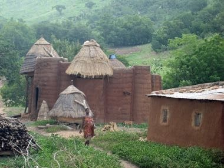

# Takienta Tower-House Builder

*Also known as: Takienta (Batammariba mud tower-houses)*

**Encyclopedia ID 1383** (permanent) · https://bpupadhyaya.github.io/world-heritage-games-site/games/1383-takienta-tower-house-builder/

*Photo: Erik Kristensen, [CC BY 2.0](https://creativecommons.org/licenses/by/2.0/), [source on Wikimedia Commons](https://commons.wikimedia.org/wiki/File:Togo_Taberma_house_02.jpg)*

Stack coil-built clay walls, a two-storey flat roof, a thatched granary cone and an animal pen to complete a fortified family compound before the rains, matching tower shapes to the plot.

## Heritage note

Part of the living heritage of Togo. Some forms of this practice carry deep meaning for the communities who keep it; here we describe the play and the craft only, with respect for its roots.

## Origins

A living tradition passed from person to person; it is not tied to a single dated origin. It belongs to the cultural world of Africa: Sahel, West and Central.

## Facts

- **Where:** Togo
- **Type:** Crafts and making
- **Era:** [Living Traditions](../../eras/living/index.md)
- **Cradle:** [Africa: Sahel, West and Central](../../cradles/africa-west/index.md)
- **Region:** Sub-Saharan Africa

## Related entries

- [Kente strip weaving](../../games/22-kente-strip-weaving/index.md)
- [Talking drum](../../games/33-talking-drum/index.md)
- [Bogolan mud cloth](../../games/86-bogolan-mud-cloth/index.md)
- [Adire indigo resist dyeing](../../games/87-adire-indigo-resist-dyeing/index.md)
- [Kuba cloth pattern puzzle](../../games/91-kuba-cloth-pattern-puzzle/index.md)
- [Adinkra Cloth Stamping](../../games/170-adinkra-cloth-stamping/index.md)

## Sources

- <https://commons.wikimedia.org/wiki/File:Togo_Taberma_house_02.jpg>
