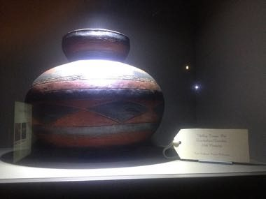

# Valley Tonga coil pottery

*Valley Tonga coil pottery*

**Encyclopedia ID 1384** (permanent) · https://equalinformation.com/world-heritage-games-site/games/1384-valley-tonga-coil-pottery/

*Photo: Nebiyu.s, [CC BY-SA 4.0](https://creativecommons.org/licenses/by-sa/4.0/), [source on Wikimedia Commons](https://commons.wikimedia.org/wiki/File:Valley_Tonga_Pot.JPG)*

Coil clay rings by hand into a pot, shape the belly and neck, burnish and incise patterns, then fire it and judge the result.

## Heritage note

Part of the living heritage of Tonga, Zambia. Some forms of this practice carry deep meaning for the communities who keep it; here we describe the play and the craft only, with respect for its roots.

## Origins

A living tradition passed from person to person; it is not tied to a single dated origin. It belongs to the cultural world of Pacific and Oceania.

## Facts

- **Where:** Tonga, Zambia
- **Type:** Crafts and making
- **Family:** Pottery, wood and metal crafts
- **Era:** [Living Traditions](../../eras/living/index.md)
- **Cradle:** [Pacific and Oceania](../../cradles/pacific/index.md)
- **Region:** Oceania and Pacific

## Related entries

- [Palauan storyboard carving](../../games/1355-palauan-storyboard-carving/index.md)
- [Zellij tile mosaic](../../games/21-zellij-tile-mosaic/index.md)
- [Swahili carved door](../../games/90-swahili-carved-door/index.md)
- [Thai fruit and vegetable carving](../../games/114-thai-fruit-and-vegetable-carving/index.md)
- [Glassblowing](../../games/121-glassblowing/index.md)
- [Azulejo tile painting](../../games/122-azulejo-tile-painting/index.md)

## Sources

- <https://commons.wikimedia.org/wiki/File:Valley_Tonga_Pot.JPG>
