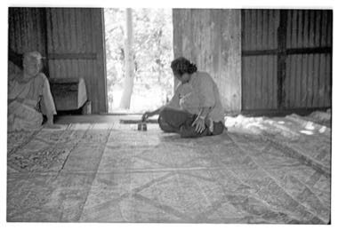

# Ngatu bark-cloth pattern rubbing

*Ngatu · kupesi*

**Encyclopedia ID 1385** (permanent) · https://bpupadhyaya.github.io/world-heritage-games-site/games/1385-ngatu-bark-cloth-pattern-rubbing/

*Photo: Ruth Bookman, [CC BY-SA 4.0](https://creativecommons.org/licenses/by-sa/4.0/), [source on Wikimedia Commons](https://commons.wikimedia.org/wiki/File:Painting_barkcloth_(tapa)_in_Tonga_(Tongatapu)_1969.jpg)*

Beat and glue bark-cloth, lay it over relief boards (kupesi) and rub in the pattern, then paint in repeating motifs row by row.

## Heritage note

Part of the living heritage of Tonga. Some forms of this practice carry deep meaning for the communities who keep it; here we describe the play and the craft only, with respect for its roots.

## Origins

A living tradition passed from person to person; it is not tied to a single dated origin. It belongs to the cultural world of Pacific and Oceania.

## Facts

- **Where:** Tonga
- **Type:** Crafts and making
- **Family:** Paper, ink and painting crafts
- **Era:** [Living Traditions](../../eras/living/index.md)
- **Cradle:** [Pacific and Oceania](../../cradles/pacific/index.md)
- **Region:** Oceania and Pacific

## Related entries

- [Lei making](../../games/449-lei-making/index.md)
- [Masi bark-cloth stencil printing](../../games/1279-masi-bark-cloth-stencil-printing/index.md)
- [Pandanus mat plaiting](../../games/1313-pandanus-mat-plaiting/index.md)
- [Ebru paper marbling](../../games/20-ebru-paper-marbling/index.md)
- [Ndebele geometric wall painting](../../games/23-ndebele-geometric-wall-painting/index.md)
- [Chinese knotting](../../games/26-chinese-knotting/index.md)

## Sources

- <https://commons.wikimedia.org/wiki/File:Painting_barkcloth_(tapa)_in_Tonga_(Tongatapu)_1969.jpg>
