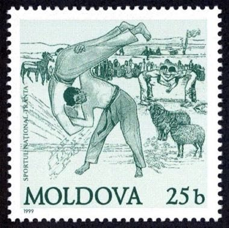

# Trânta

*Trânta · Moldovan Shepherd Wrestling*

**Encyclopedia ID 1386** (permanent) · https://equalinformation.com/world-heritage-games-site/games/1386-tranta/

*Photo: Post of Moldova, [Public domain](https://creativecommons.org/publicdomain/mark/1.0/), [source on Wikimedia Commons](https://commons.wikimedia.org/wiki/File:Stamp_of_Moldova_-_1999_-_Colnect_215923_-_Wrestling_-_Tranta.jpeg)*

Two wrestlers grip the opponent's shoulders or belt and try to throw them flat on the back within a time limit, best of three rounds.

## Heritage note

Part of the living heritage of Moldova, Romania.

## Origins

Usually placed in the era of River Valleys and First Cities (about 3000 to 1000 BCE), although its exact origins are uncertain, within the cultural world of Northern and Eastern Europe.

## Facts

- **Where:** Moldova, Romania
- **Type:** Wrestling and martial sports
- **Family:** Wrestling
- **Era:** [River Valleys and First Cities](../../eras/river-valleys/index.md) (uncertain)
- **Cradle:** [Northern and Eastern Europe](../../cradles/north-east-europe/index.md)
- **Region:** Europe

## Related entries

- [Swiss wrestling](../../games/487-swiss-wrestling/index.md)
- [Laamb Wrestling Bout](../../games/166-laamb-wrestling-bout/index.md)
- [Kurash](../../games/253-kurash/index.md)
- [Kushti / Pehlwani mud wrestling](../../games/256-kushti-pehlwani-mud-wrestling/index.md)
- [Sumo bout](../../games/359-sumo-bout/index.md)
- [Ssireum](../../games/366-ssireum/index.md)

## Sources

- <https://commons.wikimedia.org/wiki/File:Stamp_of_Moldova_-_1999_-_Colnect_215923_-_Wrestling_-_Tranta.jpeg>
