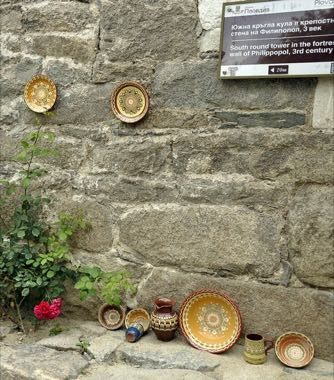

# Bulgarian Painted Pottery

*Троянска керамика · Troyan Style*

**Encyclopedia ID 1388** (permanent) · https://equalinformation.com/world-heritage-games-site/games/1388-bulgarian-painted-pottery/

*Photo: P. Hughes, [CC BY-SA 4.0](https://creativecommons.org/licenses/by-sa/4.0/), [source on Wikimedia Commons](https://commons.wikimedia.org/wiki/File:Bulgarian_Pottery.jpg)*

Paint a red-clay plate with drop-shaped slip trails and peacock-eye patterns using a horn tool, then fire it in the kiln.

## Heritage note

Part of the living heritage of Bulgaria.

## Origins

A living tradition passed from person to person; it is not tied to a single dated origin. It belongs to the cultural world of Northern and Eastern Europe.

## Facts

- **Where:** Bulgaria
- **Type:** Crafts and making
- **Family:** Pottery, wood and metal crafts
- **Era:** [Living Traditions](../../eras/living/index.md)
- **Cradle:** [Northern and Eastern Europe](../../cradles/north-east-europe/index.md)
- **Region:** Europe

## Related entries

- [Horezu ceramics](../../games/384-horezu-ceramics/index.md)
- [Skrabalai](../../games/388-skrabalai/index.md)
- [Bolesławiec Stamped Pottery](../../games/1244-bolesawiec-stamped-pottery/index.md)
- [Zellij tile mosaic](../../games/21-zellij-tile-mosaic/index.md)
- [Swahili carved door](../../games/90-swahili-carved-door/index.md)
- [Thai fruit and vegetable carving](../../games/114-thai-fruit-and-vegetable-carving/index.md)

## Sources

- <https://commons.wikimedia.org/wiki/File:Bulgarian_Pottery.jpg>
