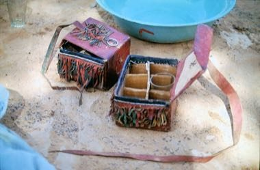

# Tuareg Tea

*Also known as: Atay · Attaya · Three Glasses*

**Encyclopedia ID 1390** (permanent) · https://bpupadhyaya.github.io/world-heritage-games-site/games/1390-tuareg-tea/

*Photo: Unrecorded; see Commons page, [CC BY 4.0](https://creativecommons.org/licenses/by/4.0/), [source on Wikimedia Commons](https://commons.wikimedia.org/wiki/File:A_Tuareg_in_northern_Mali_prepares_a_fire_for_making_tea.jpg (shows Tuareg tea case))*

Brew green tea with sugar on glowing charcoal, pour it high between glasses to raise foam and serve three rounds, each stronger, balancing heat, sugar and timing.

## Heritage note

Part of the living heritage of Niger. Some forms of this practice carry deep meaning for the communities who keep it; here we describe the play and the craft only, with respect for its roots.

## Origins

A living tradition passed from person to person; it is not tied to a single dated origin. It belongs to the cultural world of Africa: Sahel, West and Central.

## Facts

- **Where:** Niger
- **Type:** Crafts and making
- **Family:** Pottery, wood and metal crafts
- **Era:** [Living Traditions](../../eras/living/index.md)
- **Cradle:** [Africa: Sahel, West and Central](../../cradles/africa-west/index.md)
- **Region:** Sub-Saharan Africa

## Related entries

- [Krobo Powder-Glass Beads](../../games/173-krobo-powder-glass-beads/index.md)
- [Kissi Penny Forging](../../games/1314-kissi-penny-forging/index.md)
- [Zellij tile mosaic](../../games/21-zellij-tile-mosaic/index.md)
- [Swahili carved door](../../games/90-swahili-carved-door/index.md)
- [Thai fruit and vegetable carving](../../games/114-thai-fruit-and-vegetable-carving/index.md)
- [Glassblowing](../../games/121-glassblowing/index.md)

## Sources

- <https://commons.wikimedia.org/wiki/File:A_Tuareg_in_northern_Mali_prepares_a_fire_for_making_tea.jpg (shows Tuareg tea case)>
