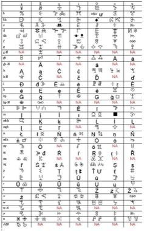

# Vai Syllabary Decoder

*Also known as: Vai script (ꕙꔤ)*

**Encyclopedia ID 1394** (permanent) · https://bpupadhyaya.github.io/world-heritage-games-site/games/1394-vai-syllabary-decoder/

*Photo: KillOrDie (attributed), [Public domain](https://creativecommons.org/publicdomain/mark/1.0/), [source on Wikimedia Commons](https://commons.wikimedia.org/wiki/File:Vai-script.jpg)*

Learn a handful of Vai syllable signs, then match, build and decode short Vai words and phrases from a tile chart, like a rebus crossword.

## Heritage note

Part of the living heritage of Liberia.

## Origins

Usually placed in the era of Crossroads and Golden Ages (about 500 to 1500), although its exact origins are uncertain, within the cultural world of Africa: Sahel, West and Central.

## Facts

- **Where:** Liberia
- **Type:** Puzzles and mind games
- **Family:** Puzzle and dexterity toys
- **Era:** [Crossroads and Golden Ages](../../eras/crossroads/index.md) (uncertain)
- **Cradle:** [Africa: Sahel, West and Central](../../cradles/africa-west/index.md)
- **Region:** Sub-Saharan Africa

## Related entries

- [Wayfinder](../../games/43-wayfinder/index.md)
- [Dalgona](../../games/100-dalgona/index.md)
- [Bozo Net Casting](../../games/169-bozo-net-casting/index.md)
- [Akan Gold-Weight Balance](../../games/171-akan-gold-weight-balance/index.md)
- [Queah](../../games/885-queah/index.md)
- [Tifinagh Letter Puzzle](../../games/1380-tifinagh-letter-puzzle/index.md)

## Sources

- <https://commons.wikimedia.org/wiki/File:Vai-script.jpg>
