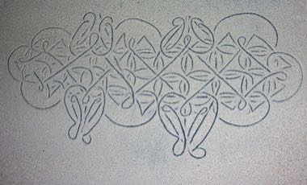

# Sand drawing

*Sandroing / tok-tok drawing · continuous line tracing*

**Encyclopedia ID 1395** (permanent) · https://bpupadhyaya.github.io/world-heritage-games-site/games/1395-sand-drawing/

*Photo: PhillipC, [CC BY 2.0](https://creativecommons.org/licenses/by/2.0/), [source on Wikimedia Commons](https://commons.wikimedia.org/wiki/File:Sand_drawing,_Vanuatu.jpg)*

Trace one unbroken line around a dot grid with your finger so that the pattern closes into a symmetric figure without lifting or retracing.

## Heritage note

Part of the living heritage of Vanuatu. Some forms of this practice carry deep meaning for the communities who keep it; here we describe the play and the craft only, with respect for its roots.

## Origins

Usually placed in the era of Modern Heritage (1800 to today), although its exact origins are uncertain, within the cultural world of Pacific and Oceania.

## Facts

- **Where:** Vanuatu
- **Type:** Puzzles and mind games
- **Family:** Puzzle and dexterity toys
- **Era:** [Modern Heritage](../../eras/modern/index.md) (uncertain)
- **Cradle:** [Pacific and Oceania](../../cradles/pacific/index.md)
- **Region:** Oceania and Pacific

## Related entries

- [Marshallese stick chart navigator](../../games/1333-marshallese-stick-chart-navigator/index.md)
- [Maori stick games](../../games/981-maori-stick-games/index.md)
- [Heu](../../games/1146-heu/index.md)
- [Hiko](../../games/1147-hiko/index.md)
- [Kingyo-sukui](../../games/3-kingyo-sukui/index.md)
- [Stone Skipping](../../games/5-stone-skipping/index.md)

## Sources

- <https://commons.wikimedia.org/wiki/File:Sand_drawing,_Vanuatu.jpg>
