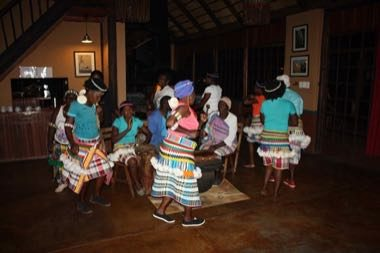

# Venda team dances

*Also known as: Venda team dances (Tshigombela · reed-pipe ensemble) · Tshigombela · reed-pipe ensemble*

**Encyclopedia ID 1397** (permanent) · https://bpupadhyaya.github.io/world-heritage-games-site/games/1397-venda-team-dances/

*Photo: South African Tourism from South Africa, [CC BY 2.0](https://creativecommons.org/licenses/by/2.0/), [source on Wikimedia Commons](https://commons.wikimedia.org/wiki/File:Venda_dancers,_Mashovhela_Bush_Lodge,_Louis_Trichardt,_Limpopo,_South_Africa_(10185242894).jpg)*

Lead a line of dancers with stamp and clap patterns over drums and reed pipes, joining in layers so every voice enters on its beat.

## Heritage note

Part of the living heritage of South Africa.

## Origins

A living tradition passed from person to person; it is not tied to a single dated origin. It belongs to the cultural world of Africa: Southern Africa.

## Facts

- **Where:** South Africa
- **Type:** Dances
- **Family:** Wind instruments
- **Era:** [Living Traditions](../../eras/living/index.md)
- **Cradle:** [Africa: Southern Africa](../../cradles/africa-south/index.md)
- **Region:** Sub-Saharan Africa

## Related entries

- [Khene](../../games/145-khene/index.md)
- [Mijwiz Double Clarinet](../../games/221-mijwiz-double-clarinet/index.md)
- [Mudhif reed-arch house](../../games/230-mudhif-reed-arch-house/index.md)
- [Lusheng](../../games/337-lusheng/index.md)
- [Launeddas Triple Pipe](../../games/400-launeddas-triple-pipe/index.md)
- [Rubboard zydeco rhythm](../../games/437-rubboard-zydeco-rhythm/index.md)

## Sources

- <https://commons.wikimedia.org/wiki/File:Venda_dancers,_Mashovhela_Bush_Lodge,_Louis_Trichardt,_Limpopo,_South_Africa_(10185242894).jpg>
