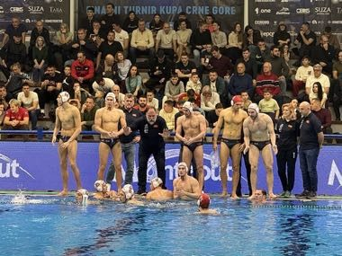

# Water Polo Sprint

*Vaterpolo*

**Encyclopedia ID 1398** (permanent) · https://equalinformation.com/world-heritage-games-site/games/1398-water-polo-sprint/

*Photo: Sportopedia, [CC BY-SA 4.0](https://creativecommons.org/licenses/by-sa/4.0/), [source on Wikimedia Commons](https://commons.wikimedia.org/wiki/File:Montenegro_national_water_polo_team_2025.jpg)*

Swim, pass and shoot in short seven-a-side matches with a shot clock, aiming past a goalkeeper at the far end.

## Heritage note

Part of the living heritage of Montenegro.

## Origins

A living tradition passed from person to person; it is not tied to a single dated origin. It belongs to the cultural world of Mediterranean.

## Facts

- **Where:** Montenegro
- **Type:** Crafts and making
- **Family:** Water sports
- **Era:** [Living Traditions](../../eras/living/index.md)
- **Cradle:** [Mediterranean](../../cradles/mediterranean/index.md)
- **Region:** Europe

## Related entries

- [Faustball](../../games/485-faustball/index.md)
- [Fijiri Pearl-Diver Sea Songs](../../games/1280-fijiri-pearl-diver-sea-songs/index.md)
- [Ice Canoe Race](../../games/1412-ice-canoe-race/index.md)
- [Jangada Sailing](../../games/1413-jangada-sailing/index.md)
- [Bequia Boat and Model Builder](../../games/1440-bequia-boat-and-model-builder/index.md)
- [Ecuavoley](../../games/1450-ecuavoley/index.md)

## Sources

- <https://commons.wikimedia.org/wiki/File:Montenegro_national_water_polo_team_2025.jpg>
